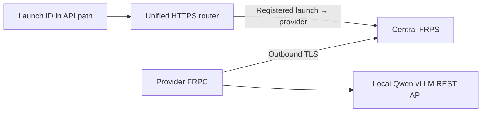

# CC Launchpad Router

A unified, launch-ID-based REST entry point for AI computing credit suppliers. **All providers must use FRPC to connect their local inference service to the platform’s central FRPS server.**

[React UI source](apps/launchpad/README.md) · [Provider hosting guide](docs/HOSTING.md) · [Platform operator guide](docs/FRP-HOSTING.md) · [中文说明](docs/README.zh-CN.md)

## One platform address, separate launches

```text
https://api.example.com/launches/<launch-id>/v1
```

Every credit launch has a unique launch ID. The platform maps it to a provider ID and exact model profile. Provider IDs identify tunnels; launch IDs identify credit launches. Multiple launches may use the same provider’s tunnel without sharing credit balances.



Providers do not publish their own Internet-facing API domains. The model and FRPC run on the GPU machine; GitHub hosts the code and instructions, not the GPU workload.

## Web application

The complete TypeScript/React UI and Google authentication backend are in [`apps/launchpad/`](apps/launchpad/). This includes the model catalog, buyer credits, supplier studio, PRL wallet, compute setup wizard and white paper download. See the [app README](apps/launchpad/README.md) for local setup, tests and Vercel deployment.

The repository root contains the FRP infrastructure and launch router. The UI is currently a demo snapshot; integration with the launch registry remains pending.

## Included

- Qwen3 8B AWQ (4-bit), served by vLLM with authenticated chat, usage and SSE streaming.
- Mandatory provider FRPC profile and central FRPS stack.
- One HTTPS API hostname with launch-ID routing.
- Provider provisioning, launch registration and private registration lists.
- Per-provider credentials, TLS server verification and route-ownership checks.
- Unit tests and an optional real FRP integration test using a mock inference API.

## Quick start: platform operator

Use a public Linux server with Docker, Compose v2, Python 3.11+ and OpenSSL. Configure DNS and firewall as described in the [operator guide](docs/FRP-HOSTING.md).

```bash
python3 scripts/frp_admin.py init --server frps.example.com --api-domain api.example.com
python3 scripts/frp_admin.py add --id gpu-001
python3 scripts/frp_admin.py launch --id launch-001 --provider gpu-001
docker compose -f frp/server/compose.yaml up -d
```

Replace example domains and IDs with actual platform values. Deliver only `.secrets/frp-bundles/gpu-001/` to that provider through a secure channel. Never publish server private keys or provider bundles.

## Quick start: computing provider

Use a Linux x86_64 NVIDIA GPU machine with Docker, Compose v2, NVIDIA drivers/Container Toolkit and Python 3. Start with 16GB+ VRAM as a conservative demo planning target, not a measured minimum. Apple GPU acceleration is not supported by this kit.

```bash
git clone https://github.com/xgaozoyoe/cc-launchpad-router.git
cd cc-launchpad-router
python3 scripts/setup.py
mkdir -p .secrets/frp-provider
```

Copy the platform-issued `frpc.toml`, `ca.crt` and `token` into `.secrets/frp-provider/`, restrict their permissions, then:

```bash
docker compose -f compose.yaml -f compose.frpc.yaml up --build -d
python3 scripts/smoke.py
python3 scripts/smoke.py --base-url https://api.example.com/launches/launch-001/v1
```

Wait for model loading before running the tests. Use the platform’s real hostname and assigned launch ID. The smoke test reads the supplier API key from local `.env`; it is an operator test, not a buyer authentication flow.

## REST API

Launch-scoped endpoints:

```text
GET  /launches/<launch-id>/v1/models
POST /launches/<launch-id>/v1/chat/completions
```

Example request body:

```json
{
  "model": "qwen3-8b-awq",
  "messages": [{"role": "user", "content": "Explain computing credits in one sentence."}],
  "max_tokens": 256,
  "temperature": 0.7,
  "top_p": 0.8,
  "chat_template_kwargs": {"enable_thinking": false},
  "stream": false
}
```

Responses use `choices[0].message.content` and `usage.prompt_tokens`, `usage.completion_tokens`, `usage.total_tokens`. For SSE set `stream: true` and `stream_options: {"include_usage": true}`. The router strips the launch prefix and forwards to the provider’s standard `/v1` endpoint. Unknown/disabled launches or mismatched model bindings are rejected.

## Management

```bash
python3 scripts/frp_admin.py list
curl --fail http://127.0.0.1:9090/providers
curl --fail http://127.0.0.1:9090/launches
```

These are private central-host registration lists, not public buyer endpoints or proof of live capacity.

## Implementation limits

This is a transport/provisioning starter. The router’s operator test mode forwards the supplier Bearer key. Production must authenticate buyers, validate credits for the launch ID, reserve credits, inject the supplier key from a server-side vault, meter accepted usage and burn the correct launch’s credits. Buyer authentication, the credit ledger, vault, issuance transaction, PRL settlement and failover are not implemented here. Never give supplier keys to buyers.

The existing website’s setup and inference are simulated and its launch records are not automatically synchronized with this registry. The platform should register the same launch ID when issuance is approved. Aggregate capacity across multiple launches must be checked before issuing real credits.

## Versions and verification

- FRPC and FRPS: `v0.71.1`.
- vLLM: `v0.10.2`.
- Qwen repository: `Qwen/Qwen3-8B-AWQ`, revision `93eb32ea9ef98cc266b85563ad0dd29e5f2940b9`, AWQ 4-bit, 4096 context.
- Tests passed for real local FRP TLS transport, launch-ID routing, API-key forwarding, streamed output and rejection of unauthorized routes, using a mock inference service.
- GPU model loading, Docker deployment and public HTTPS certificate issuance have not been verified here.

```bash
python3 -m unittest discover -s tests -v
```

The optional real-tunnel test requires `FRP_BIN_DIR` pointing to verified official matching binaries. Keep `.env` and `.secrets/` out of Git.
