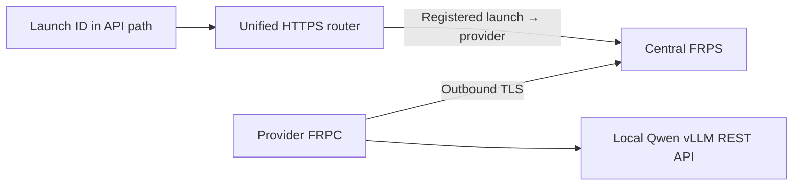

# CC Launchpad Router

A unified, launch-ID-based REST entry point for AI computing credit suppliers. **All providers must use FRPC to connect their local inference service to the platform’s central FRPS server.**

[React UI source](apps/launchpad/README.md) · [Provider hosting guide](docs/HOSTING.md) · [Platform operator guide](docs/FRP-HOSTING.md) · [中文说明](docs/README.zh-CN.md)

## One platform address, separate launches

```text
https://api.example.com/launches/<launch-id>/v1
```

Every credit launch has a unique launch ID. The platform maps it to a provider ID and exact model profile. Provider IDs identify tunnels; launch IDs identify credit launches. The generic transport registry can associate several launches with a provider. The active stake workflow instead reserves one Provider ID (the full stake transaction hash) per project; no cross-project tunnel reuse is integrated.



Providers do not publish their own Internet-facing API domains. The model and FRPC run on the GPU machine; GitHub hosts the code and instructions, not the GPU workload.

## Web application

The complete TypeScript/React UI and Google authentication backend are in [`apps/launchpad/`](apps/launchpad/). This includes the model catalog, buyer credits, My launches, PRL wallet, compute setup wizard and white paper download. See the [app README](apps/launchpad/README.md) for local setup, tests and Vercel deployment.

The production workspace runs at https://riddle.xyz. Google login, account-owned MongoDB projects, wallet binding, Sepolia staking and finalized Launch ID issuance are connected. Buyer credits, PRL wallet and public-pool screens remain simulations. The separate Python FRP registry is not synchronized with the active Rust project records. See [implementation status](docs/IMPLEMENTATION-STATUS.md) before following infrastructure examples.

## Included in the separate inference/FRP reference kit

- Qwen3 8B AWQ (4-bit), served by vLLM with authenticated chat, usage and SSE streaming.
- Mandatory provider FRPC profile and central FRPS stack.
- One HTTPS API hostname with launch-ID routing.
- Provider provisioning, launch registration and private registration lists.
- Per-provider credentials, TLS server verification and route-ownership checks.
- Unit tests and an optional real FRP integration test using a mock inference API.

## Stake contract and event monitor

The [stake contract and monitor guide](docs/STAKING-CONTRACT.md) covers the ERC-20 escrow, finalized `ProjectStaked` events, durable Launch ID issuance and private FRPC bundles. The development default is Ethereum Sepolia (11155111); the deployed test-only tPRL and stake contract addresses are recorded in [the Sepolia manifest](config/deployments/sepolia.json). Project drafts use Rust + MongoDB; simulated purchases and balances are isolated in the Demo workspace. Wallet binding, operator project registration and finalized stake-event indexing are now integrated in Rust; see [the active staking guide](docs/RUST-STAKING.md). Functional RPC checks and [wallet-authorized admin review](docs/ADMIN-REVIEW.md) are integrated. Manual demo capacity approval and finalized `verifyProject` acceptance alone do not enable sales; a separate credit offering and paid API consent are required.

## Stake-gated publishing

**[Project lifecycle and integration status](docs/PROJECT-LIFECYCLE.md)** is the current publishing specification: create project → verify stake on the default chain → issue Launch ID → provision project credential (pending integration) → verify RPC within 24h of the stake block → open sales. Provider ID is the stake transaction hash.

The UI demonstrates this flow. The backend includes an EVM receipt/event verifier and refuses real stake confirmation until the platform default chain/token/deployed-contract settings are configured. Manual CLI `add` and `launch` issuance is disabled. The central infrastructure can still be initialized with `frp_admin.py init`; authenticated draft APIs are available in Rust. Owner-only Linux FRPC bundles are connected; functional RPC checks and signed admin acceptance are available; measured capacity acceptance remains pending. See [provider bundles](docs/PROVIDER-BUNDLES.md). The older Python monitor uses SQLite and remains a separate reference implementation.

## Quick start: computing provider

Use a Linux x86_64 NVIDIA GPU machine with Docker, Compose v2, NVIDIA drivers/Container Toolkit and Python 3. Start with 16GB+ VRAM as a conservative demo planning target, not a measured minimum. Apple GPU acceleration is not supported by this kit.

```bash
git clone https://github.com/xgaozoyoe/cc-launchpad-router.git
cd cc-launchpad-router
python3 scripts/setup.py
mkdir -p .secrets/frp-provider
```

Copy the platform-issued `frpc.toml`, `ca.crt` and `token` into `.secrets/frp-provider/`, restrict their permissions, then:

```bash
docker compose -f compose.yaml -f compose.frpc.yaml up --build -d
python3 scripts/smoke.py
python3 scripts/smoke.py --base-url https://api.example.com/launches/launch-001/v1
```

Wait for model loading before running the tests. Use the platform’s real hostname and assigned launch ID. The smoke test reads the supplier API key from local `.env`; it is an operator test, not a buyer authentication flow.

## REST API

Launch-scoped endpoints:

```text
GET  /launches/<launch-id>/v1/models
POST /launches/<launch-id>/v1/chat/completions
```

Example request body:

```json
{
  "model": "qwen3-8b-awq",
  "messages": [{"role": "user", "content": "Explain computing credits in one sentence."}],
  "max_tokens": 256,
  "temperature": 0.7,
  "top_p": 0.8,
  "chat_template_kwargs": {"enable_thinking": false},
  "stream": false
}
```

Responses use `choices[0].message.content` and `usage.prompt_tokens`, `usage.completion_tokens`, `usage.total_tokens`. For SSE set `stream: true` and `stream_options: {"include_usage": true}`. The router strips the launch prefix and forwards to the provider’s standard `/v1` endpoint. Unknown/disabled launches or mismatched model bindings are rejected.

## Management

```bash
python3 scripts/frp_admin.py list
curl --fail http://127.0.0.1:9090/providers
curl --fail http://127.0.0.1:9090/launches
```

These are private central-host registration lists, not public buyer endpoints or proof of live capacity.

## Implementation limits

This is a transport/provisioning starter. The router’s operator test mode forwards the supplier Bearer key. Production must authenticate buyers, validate credits for the launch ID, reserve credits, inject the supplier key from a server-side vault, meter accepted usage and burn the correct launch’s credits. The integrated Rust central service now supplies wallet-bound purchasing, private provider-key injection, usage reservations and batch burns for the test credit contract. This separate reference router does not implement that paid ledger. PRL release and failover remain future work. Never give supplier keys to buyers.

The default website uses real server projects and provider setup. Buyer inference is available only as an explicit Demo simulation; real server projects and finalized Launch IDs are not automatically synchronized with this separate reference FRP registry. The platform should register the same launch ID when issuance is approved. Aggregate capacity across multiple launches must be checked before issuing real credits.

## Versions and verification

- FRPC and FRPS: `v0.71.1`.
- vLLM: `v0.10.2`.
- Qwen repository: `Qwen/Qwen3-8B-AWQ`, revision `93eb32ea9ef98cc266b85563ad0dd29e5f2940b9`, AWQ 4-bit, 4096 context.
- Tests passed for real local FRP TLS transport, launch-ID routing, API-key forwarding, streamed output and rejection of unauthorized routes, using a mock inference service.
- GPU model loading and the Docker deployment have not been verified. The native Ubuntu web/API deployment and public HTTPS at riddle.xyz have been verified; this does not verify the FRP inference stack.

```bash
python3 -m unittest discover -s tests -v
```

The optional real-tunnel test requires `FRP_BIN_DIR` pointing to verified official matching binaries. Keep `.env` and `.secrets/` out of Git.

## Rust central backend

The new central service foundation uses **Rust + MongoDB**. See [central/README.md](central/README.md) for startup, signed requests, draft APIs and current integration limits. The Rust API and UI are deployed at https://riddle.xyz, with native FRPS authorization. The older Python FRP/stake stack remains a separate reference implementation. Finalized stake events now reserve Launch IDs. Wallet-authorized manual demo capacity approval and finalized on-chain acceptance are available. Measured capacity benchmarking remains unfinished. Per-launch Sepolia test credit purchases and real inference are available for configured offers; acceptance alone does not open sales.

## Run the integrated workspace

```sh
python3 scripts/stack.py local
```

Open http://localhost:4174. The project dialog now saves drafts through the same-origin session gateway to Rust + MongoDB. [Single-host deployment and local testing](deploy/stack/README.md) includes Docker Compose, Google callback setup and the current integration scope.

## Active staking flow

[Wallet binding and finalized staking](docs/RUST-STAKING.md) documents the live Rust/MongoDB implementation, API, chain configuration and tests. The existing Python monitor is a separate legacy reference, not a second production writer.

## Documentation and collateral rules

[Implementation status](docs/IMPLEMENTATION-STATUS.md) distinguishes deployed behavior, separate reference code and agreed but unimplemented product rules. The downloadable PowerPoint is a concept white paper, not a statement of deployed capabilities. In My launches, PRL collateral is split into locked, free/withdrawable and returned balances. The current escrow supports full refunds/releases only; proportional unlocking after provider-delivered, settled credits is agreed but not implemented.

The default website now shows the [real Launchpad directory](docs/REAL-LAUNCHPAD.md), actual project verification and the backend-supported model list. Purchases remain disabled. Seeded offers, simulated balances and public-pool illustrations are available only in the explicitly labelled Demo workspace (`/#demo`); default project creation never falls back to a fake launch.

Verified providers can enable [limited real prompt trials](docs/PROMPT-TRIALS.md): signed-in users test actual inference before purchasing, with server-enforced account quotas, project caps and concurrency limits. Preview access does not activate credit sales or settlement.

The implemented Sepolia test [purchase and spending flow](docs/CREDIT-SPENDING.md) covers fixed-price ERC-1155 offerings, ETH purchase/usage escrow, backend reservations, real inference, finalized batch burns, earned provider revenue and unused-credit withdrawal. Existing PRL remains locked; proportional release is not part of this test.

## Modular custody and existing-project migration

The modular contracts separate PRL custody, ETH reserves, credit ownership and usage accounting from sale/settlement modules. Atomic V1 migration and the Rust/React path are implemented and tested; an inactive Sepolia target is deployed. Existing assets stay on V1 until the 48-hour governance step, all-holder consents, exact provider prerequisites, atomic commitment and finalized ledger activation are complete. See the [migration runbook](docs/CONTRACT-CUTOVER.md), [deployment record](config/deployments/modular-sepolia.json) and [test evidence](config/test-results/modular-migration.json).
