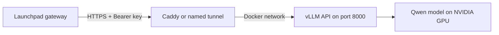

# CC Launchpad Router — Qwen Supplier Starter

Run a quantized Qwen model on your own NVIDIA GPU and expose an authenticated, OpenAI-compatible REST API for an AI Computing Credit Launchpad supplier.

**[Preferred: platform-managed FRP hosting](docs/FRP-HOSTING.md)** · [Standalone hosting alternatives](docs/HOSTING.md) · [中文说明](docs/README.zh-CN.md)

This starter provides the **supplier inference endpoint**. Credit issuance, PRL staking, payments, model verification and platform routing remain outside this repository.

## What is included?

- Qwen3 8B AWQ (4-bit) served through vLLM.
- Dockerfile and Compose configuration, a persistent model cache, and a health check.
- Generated API key and authenticated model / chat endpoints.
- A smoke test for authentication, real generation, token usage and SSE streaming.
- Platform-managed FRPC → FRPS hosting with assigned provider IDs, HTTPS endpoints and a private registration list.
- Optional Caddy HTTPS reverse proxy for a public GPU server.
- Optional named Cloudflare Tunnel for a home GPU behind NAT.

GitHub hosts the code and documentation. **Your GPU machine hosts inference**; GitHub Pages and Vercel do not run this model container.

## Requirements

- Linux x86_64 with a supported NVIDIA GPU, NVIDIA drivers and NVIDIA Container Toolkit.
- Docker Engine and Docker Compose v2.
- Python 3 for local inference setup; Python 3.11+ and OpenSSL for platform FRP provisioning/tests. No extra pip dependencies.
- Start with 16GB+ GPU VRAM, 16GB+ host RAM and 30GB+ free disk as conservative demo planning targets. These are not measured minimum requirements; context length and concurrency affect usage.
- Internet access for the initial image and model download.

This configuration does not use Apple Silicon GPU acceleration or AMD GPUs. WSL2 GPU operation has not been tested here.

## Quick start

Run these commands **on the GPU machine**:

```bash
git clone https://github.com/xgaozoyoe/cc-launchpad-router.git
cd cc-launchpad-router
python3 scripts/setup.py
docker compose up --build -d
docker compose logs -f inference
```

The setup script creates a random API key in an owner-readable `.env` file, without printing it. It will not overwrite an existing file. First startup downloads the model and may take a while.

After the model is ready, open another terminal in the same directory:

```bash
python3 scripts/smoke.py
```

The test makes two actual inference requests. It checks that unauthenticated access is rejected, the model exists, and normal and streamed responses include usage.

Stop with `docker compose down`. The model cache remains in a Docker volume; using `down -v` deletes it.

## REST API

| Setting | Default |
| --- | --- |
| Local API base URL | `http://127.0.0.1:8000/v1` |
| Served model ID | `qwen3-8b-awq` |
| Model repository | `Qwen/Qwen3-8B-AWQ` |
| Quantization | AWQ 4-bit |
| Context limit | 4096 input + output tokens |
| Concurrent sequences | 2 |
| Authentication | `Authorization: Bearer <INFERENCE_API_KEY>` |

Endpoints:

- `GET /health`: local health probe, outside `/v1`.
- `GET /v1/models`: authenticated model discovery.
- `POST /v1/chat/completions`: authenticated chat inference.

Example JSON request body:

```json
{
  "model": "qwen3-8b-awq",
  "messages": [{"role": "user", "content": "Explain computing credits in one sentence."}],
  "max_tokens": 256,
  "temperature": 0.7,
  "top_p": 0.8,
  "chat_template_kwargs": {"enable_thinking": false},
  "stream": false
}
```

Read the answer from `choices[0].message.content` and counts from `usage.prompt_tokens`, `usage.completion_tokens` and `usage.total_tokens`. `chat_template_kwargs` is a Qwen/vLLM extension used here to disable thinking for the demo.

For streaming, set `stream: true` and `stream_options: {"include_usage": true}`. Read SSE chunks, the final usage record and `[DONE]`.

The smoke script demonstrates these requests using Python's standard library, without exposing the API key.

## Make the API reachable from Launchpad

`127.0.0.1` works only on the GPU host. An external gateway needs a reachable HTTPS address.



Use the **[FRP hosting guide](docs/FRP-HOSTING.md)** for the platform-managed path: providers run `frpc` beside inference, connect to your central `frps`, and receive stable URLs such as `https://gpu-001.compute.example.com/v1`. The central operator assigns identities and can list registered providers uniformly.

The older [standalone hosting guide](docs/HOSTING.md) remains available for suppliers managing their own HTTPS domain or Cloudflare tunnel.

Then test the public URL:

```bash
python3 scripts/smoke.py --base-url https://inference.example.com/v1
```

Replace the example hostname with your own. Keep the API key server-side. Temporary Cloudflare Quick Tunnels are unsuitable for streamed inference because they do not support SSE.

## Configuration and credentials

See `.env.example` for tunable context, concurrency and GPU memory settings. Lower context/concurrency if GPU memory is insufficient.

- Never commit `.env`, `.secrets/`, inference keys or tunnel tokens.
- Keep port 8000 on localhost; publish through HTTPS or a deliberately configured private network.
- No Google OAuth credentials, PRL wallets or buyer data are required by this starter.
- A configured endpoint does not prove ownership, availability or capacity. Real issuance needs independent checks and ongoing monitoring.

## Versions and verification status

- vLLM image: `vllm/vllm-openai:v0.10.2`.
- Model revision: `93eb32ea9ef98cc266b85563ad0dd29e5f2940b9`.
- Optional proxy / tunnel profiles use upstream rolling tags; review and pin digests before production.
- Python syntax, startup validation, YAML structure and smoke-client logic have been checked. **Image builds, model loading and generation have not been verified on an NVIDIA GPU in this project.**
- A real localhost FRP integration test passed with official v0.71.1 binaries and a mock inference API (TLS tunnel, API authentication and route-ownership rejection).
- The Launchpad website currently uses simulated readiness and inference. Saving an endpoint there does not connect this service or burn real credits.

## Project layout

```text
Dockerfile                 vLLM supplier image
compose.yaml               Local GPU inference
compose.frpc.yaml          Provider FRP connector
frp/server/compose.yaml    Central server, authorization registry and HTTPS
scripts/frp_admin.py       Issue provider bundles and list registrations
compose.https.yaml         Optional standalone Caddy HTTPS service
compose.tunnel.yaml        Optional named tunnel connector
deploy/Caddyfile            Restricted REST reverse proxy
scripts/setup.py           Generate local API credentials
scripts/serve.py           Validate settings and start vLLM
scripts/healthcheck.py     Local readiness probe
scripts/smoke.py           Auth, generation and streaming verification
docs/HOSTING.md             End-to-end hosting instructions
```

## References

- [Qwen deployment with vLLM](https://qwen.readthedocs.io/en/latest/deployment/vllm.html)
- [Official Qwen3 8B AWQ model](https://huggingface.co/Qwen/Qwen3-8B-AWQ)
- [NVIDIA Container Toolkit](https://docs.nvidia.com/datacenter/cloud-native/container-toolkit/latest/install-guide.html)
- [vLLM Docker deployment](https://docs.vllm.ai/en/v0.10.2/deployment/docker.html)
