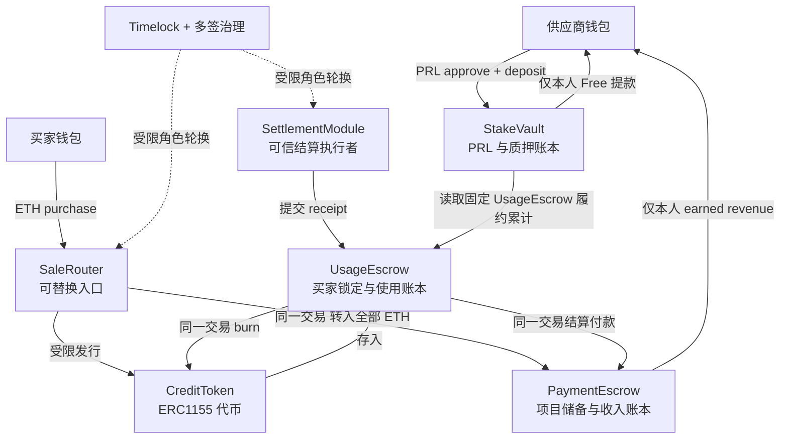

# 合约架构决策：稳定资产与账本，可替换业务模块

状态：2026-11-08，拆分合约核心已有本地实现和测试，尚未部署或接入线上后台。此设计取代同仓库 `LaunchStakeV2` / `ComputeCreditsV2` 原型的部署方向；原型只保留为比例计算和测试参考。现有线上 V1 不变。

## 1. 目标与边界

本次先定稿资产保管、账本、权限和迁移边界，再实现并演练一次迁移。不是简单把 treasury 地址提成配置项，也不把所有资产放到管理员钱包。

设计选择：不使用可任意 delegatecall 的资产代理。稳定层合约不可升级，业务模块通过受控角色轮换；稳定层需要变更经济规则时，仍需独立版本和迁移。不能承诺以后永远不需要迁移。

先保持当前计费：1 credit = 1 completion token，input 不收费；模型、供应商、单价、承诺总量按项目固定。重新设计计费另开版本，不能修改已售权益。PRL 解锁分母是承诺发行总量，不是已售数量。

## 2. 模块与资金位置

| 模块 | 稳定存储/职责 | 可否保管资产 | 更换方式 |
| --- | --- | --- | --- |
| ProjectRegistry | 项目标识、provider、模型 hash、承诺量、单价、原时间、生命周期 | 不收款 | 稳定层；验收模块可轮换，已售条款不可改 |
| StakeVault | initial、withdrawn、slashed（若未来启用）、质押时间；计算 Locked/Free | PRL | 稳定层，不提供任意转出 |
| CreditToken | 项目 ERC1155 余额与铸造总量，固定发行上限 | 不收 ETH/PRL | 稳定层；只允许固定授权 escrow burn，受限销售模块 mint |
| UsageEscrow | 每个项目/买家的 locked、reserved、consumed；receipt 去重；providerDelivered | 托管 credits | 稳定层；结算模块可轮换，账本不迁移 |
| PaymentEscrow | 每个项目 reserve、earned、claimed、累计付款/结算 | ETH | 稳定层；付款结算入口固定为 UsageEscrow |
| SaleRouter | 购买入口，调用稳定层完成一次原子购买 | 不留存资金 | 可换；不得自行更改条款、付款归属或供应商 |
| SettlementModule | 将后台已履约记录送上链，调用 UsageEscrow | 不留存资金 | 可换；不能直接划走 PRL/ETH |
| AcceptanceModule | 管理员验收签名/链上操作 | 不留存资金 | 可换；Registry/Vault 自己执行 deadline 和状态约束 |

Registry、三个 escrow/vault 和 token 的相互引用通过工厂同次部署、一次性绑定后封存。不得暴露随时 `setVault` / `setLedger`。创建项目必须能追溯固定合约组版本，前后台不能仅用一个全局新地址覆盖所有旧记录。

## 3. 稳定层必须自己执行的约束

### ProjectRegistry

- 项目 key 为现有 UUID 的 SHA-256；业务 Launch ID 和原 provider ID 保持不变。
- 固定 provider、modelHash/revision、committedCredits、weiPerCredit、unitVersion、stakeAmount；一经首次质押/售出不得改经济条款。
- 保留 stake 区块时间，验收必须在 stake 时间 + 24h 之前完成；业务模块不能传任意当前时间延长窗口。
- 销售暂停和服务暂停分开：暂停新增购买不应自动使既有 credits 失效；紧急停止服务有明确 UI 与恢复流程。

### CreditToken

- `issued <= committedCredits`，burn 不恢复可发行额度，防止一份承诺反复出售。
- mint 的项目/收款证据必须来自受限购买路径；销售模块不能免费 mint 任意数量。应由 PaymentEscrow 收款成功后授予一次性发行凭据，Token 消费该凭据。
- 托管 credits 只有 UsageEscrow 可以 burn；普通钱包只允许本人转移或本人销毁自己的 tokens。本人主动销毁不算供应商履约、不产生收入、不解锁 PRL。
- wallet transfer 不改变项目经济条款；再次存入时按实际接收量记账。

### UsageEscrow

- `locked >= reserved`；每次生成使用不可重放的 reservationId。买家签名绑定 chain、escrow、project、buyer、最大扣费、nonce、expiry；用户可给有期限/额度的会话授权，后台不能因连接钱包获得无限消费权。
- settle 只能扣实际已保留且不超过 max 的 credits；失败释放 reservation；不确定请求暂保留且可追踪，不能既退款又 burn。
- receipt 包含 project、buyer、reservationId、usageId、actualCredits、deliveryKind、provider；校验后原子 burn、更新账本、调用 PaymentEscrow。
- 同一 usageId 和 reservationId 只能消费一次；跨 module/批次重放也失败。去重数据在稳定账本，不能只存在可替换 SettlementModule 中。
- `deliveryKind = provider` 才增加 providerDelivered；fallback、trial、migration retirement 都不增加。fallback 付款归属需要单独规则；首版禁止未定义的 fallback settlement，不能冒充 provider。
- 提取 credits 必须排除 reserved；完成后减少 escrow 余额和 locked，避免与后台在途请求双花。保留现有提款对账原则。

### PaymentEscrow

- 买家每笔付款先记入明确项目的 reserve，不能因为买入就成为供应商可领取收入。
- 支付只能来自固定 UsageEscrow 的有效 settlement；按不可变项目单价计算，`settledValue <= reserve`。
- provider settlement 将 reserve 转 earned；provider 本人提取时先减 earned 再转款，使用重入防护。
- 单个项目不能动用其他项目的 reserve。多项目共享 ETH 地址不代表账本可以混用。
- 没有管理员 sweep 储备接口，没有“更换功能合约即转走全部 ETH”的接口。强制转入的 surplus 不计入任何用户权益，处置如需支持须独立限定规则。
- 未消费 credits 暂维持当前无 ETH 退款规则，必须在 UI 和条款中明确；迁移不会给管理员新增任意退款/没收权。

### StakeVault

- deposit 实际余额增量必须等于要求 PRL，拒绝 fee-on-transfer 等未支持资产。
- `unlocked = floor(initial * providerDelivered / committedCredits)`，向下取整，用全精度乘除。
- `Free = unlocked - withdrawn`，`Locked = initial - unlocked`，没有 slash 时 `Locked + Free + withdrawn = initial`。
- 固定读取 UsageEscrow 的履约累计，不能由 SettlementModule 调用 `unlock(arbitraryAmount)`。
- withdraw 仅 provider 本人，amount 不超过 Free；withdraw 后项目仍可服务、继续结算。不得沿用 V1 全额 release 管理员旁路。
- 未验收超时退款单独限定为 AwaitingRPC；退款后禁止销售/再次解锁。
- 本轮不启用 slash；未来 slash 必须定义争议与上限，并重审上述恒等式，不预留任意管理员没收入口。

## 4. 替换业务模块的治理

- 正式部署管理员由多签控制 Timelock，正常角色替换至少 48 小时延迟。测试网也使用相同流程进行演练，不把 EOA 即时管理员当最终方案。
- grant/revoke 的目标是明确角色，不授予任意 execute/delegatecall 权限。只有 SaleRouter 获购买入口权限，SettlementModule 获 settle 权限；都没有提款或改经济条款权限。
- 替换前暂停目标入口、处理在途请求，验证新模块，按同一治理批次撤旧授权/授新授权，恢复入口。receipt/nonce 去重留在 UsageEscrow，旧模块失权后不能调用。
- emergency guardian 仅能暂停受影响入口，不能提款、改余额、取消治理延迟或给自己加权限；恢复由治理执行。提款是否暂停由具体风险决定，不能一个 pause 永久冻结所有正常权利。
- **信任边界仍然存在**：链上无法独立证明一次 AI 回答有用、模型未被伪造、token 计数绝对真实。可信结算者仍可能提交假的交付记录；隔离资金不能消除这个 oracle 风险。reservation 授权限制扣费范围，审计记录提供追责；争议/延迟解锁策略需要独立产品决定，不能声称本轮已经解决。

## 5. 正常端到端流程

1. 创建项目并固定条款；provider 向 StakeVault 质押；monitor 等 finalized 后分配/展示连接信息。
2. FRPC/RPC 测试及 capacity 决策完成，由授权验收模块在 deadline 前验收。验收确认后开启销售。
3. 买家调用 SaleRouter；同一笔交易完成 PaymentEscrow 入账、CreditToken 受限发行、UsageEscrow 买家入账。任一步失败全部 revert，不允许付钱后无 credits。
4. monitor 追踪 submitted → mined → finalized → indexed；UI 同时显示 tx hash、金额、项目、区块与索引进度，未到账不能只显示 pending finality。
5. 买家授权生成额度并创建 reservation；后台经固定 launch route 调用模型；失败释放额度，成功提交 receipt。
6. settle 原子 burn + reserve 转 earned；providerDelivered 仅在有效 provider burn 时增加。
7. monitor 等 finalized 更新用户账本。供应商看到 Locked / Free / Returned 和对应 settlement/withdraw tx；可本人签名提取 Free。

合约只读取 canonical 链当前状态，不能判断 RPC 的 finalized 标签。前台等待 finalized 是 UX/索引规则，不是能从根本上禁止提前提款的链上时间锁；如果需要额外争议期，应在 Vault 明确实现，不能用 UI 提示代替。

## 6. 迁移接口与不可逆边界

一次迁移指一次最终资产/权益交接，不代表没有准备交易（部署、角色授权、精确 allowance、预存、用户签名）。

旧迁移方案的盘点方法和 immutable 限制仍成立，但目标改为这一套稳定层。旧合同没有直接 ETH reserve 迁移入口；仍需要提供方临时预存新储备、全部余额持有人同意，以及旧 credits 迁移注销与真实交付严格分开。

MigrationImporter 是单用途、受限项目/计划 hash/数量/期限的导入入口。导入字段必须覆盖：

- 原 provider、project UUID/key、launch/provider ID 对应证明、modelHash、经济条款和最初 stake 时间；
- 初始 PRL、已提取/已罚没历史（当前均为 0）、真实历史 providerDelivered；
- 累计 issued、真实 burned、各买家未消费余额、wallet token 状态和剩余 ETH reserve；
- snapshot block/hash、旧/新合约地址、全部 holder consent、nonce、一次性 consumed 标志。

只导入实际未消费 credits，历史 burned 以封存基线保存而不是再次 mint。历史迁移注销不调用普通 provider settlement 入口。首轮目标要求旧 wallet tokens=0、无在途 reservation/withdrawal。

原子 coordinator 完成旧 credits 退出/注销、新储备与余额导入、旧 PRL 释放并精确存入新 Vault；任何差额或校验失败整体 revert。最终确认后才切换数据库 ledger epoch。旧 PRL release 和旧 burn 一旦 final 不可回退，之后只能暂停/修复/向前迁移。

导入入口封存后不可重新开启。若无法实现上述原子性、余额对账或全体同意，停止并保留 V1，不以手工改数据库代替迁移。

## 7. 实现和验收顺序

1. 定稿接口/不变量，新增模块放在独立目录；原 V1 和旧 V2 原型不覆盖。
2. 完成工厂部署及一次性绑定，稳定层单测：越权 mint/burn/解锁、跨项目挪用、重入、双花、重放、部分提款、过期验收、舍入与极值。
3. 实现可替换模块并演练 Timelock 轮换，确认资产和账本地址完全不变。
4. Rust 后台增加 contract-group/ledger-epoch 路由；monitor 从每组 deployment block 索引所有事件。服务密钥不得因旧项目仍运行而全局替换。
5. 本地完整链路：stake → verify → buy → reserve → real fixture inference → settle/burn → Free → withdraw；覆盖失败和并发。
6. 实现 MigrationImporter/Coordinator；fork 旧快照，逐余额核对并演练原子失败、旧交易 pending、reorg、旧模块撤权、重复迁移。
7. Sepolia 小额独立项目演练，再生成现有项目最新冻结快照和具体待签交易供审核。
8. 最后才执行现有项目迁移。

当前进度：第 2 步的核心绑定/权限/守恒测试和第 3 步的本地 Timelock 轮换已通过；第 5 步仅完成 Anvil + 带鉴权 HTTP fixture 的合约交易联调，尚未接入真实 Rust API/网页。第 4、6、7、8 步尚未完成。不能将本地测试当成已上线或已具备迁移能力。

## 8. 必须保留的证据

- 每组稳定合约地址/代码 hash/版本，模块角色、治理 delay 与部署 tx。
- 真实使用与迁移注销不同事件及数据库分类。
- 钱包可见的购买、授权、提款和结算 tx；finalized 区块与已索引区块分别显示。
- 迁移前后资产守恒、每用户余额、历史履约、ETH reserve/earned/claimed 对账报告。
- 文档、白皮书和 UI 标记设计/实现/已部署三个状态，避免再次把计划能力当成当前能力。

## 9. 本地实现对应关系与待办

代码在 `contracts/src/modular/`，测试在 `contracts/test/ModularProtocol.t.sol` 和 `tests/modular_protocol_e2e.py`。使用说明见 [模块实现说明](MODULAR-CONTRACTS.md)。

- `ProjectRegistry` 固定经济条款并执行 24h deadline；验收暂用可治理轮换的 ACCEPTANCE_ROLE，独立 AcceptanceModule 尚未实现。
- `CreditToken` 只接受固定 PaymentEscrow 在同次收款交易中发行，不能向销售模块开放免费 mint。
- `UsageEscrow` 保存 EIP-712 nonce、reservation、locked/reserved/consumed、receipt 去重和 providerDelivered；当前仅支持 provider 交付。每次 reservation 最长 24h，过期未结算可由任何人释放；这是新的链上使用授权流程，尚未接入前端。会话授权、批量 settlement 暂未实现。
- `StakeVault` 固定读取 UsageEscrow，支持同比例解锁和本人部分提款；无全额管理员 release。
- `PaymentEscrow` 按项目隔离 reserve/earned/claimed，无 admin sweep；本人销毁钱包 credits 不解锁 PRL、不获得 ETH 退款，可能留下不能领取的 reserve，UI 必须明确此结果。
- `SaleRouter` / `SettlementModule` 可治理替换。`GovernedAccess` 封存管理员地址，防止 Timelock 延迟授予 EOA 默认管理员后绕过后续延迟；`LaunchpadTimelock` 的延迟固定为 48h，不允许降为 0。
- `TestnetProtocolFactory` 在一次构造交易中部署并封存固定引用、撤销工厂管理员。仅允许 Sepolia/本地测试链；生产多签尚未配置。部署前仍必须检查 Timelock 字节码与角色，而不只信任地址的 getter 返回值。
- 导入/迁移、双合约组 monitor、Rust/前端授权协议、真实模型联调与多签演练均未完成；线上保持 V1。
