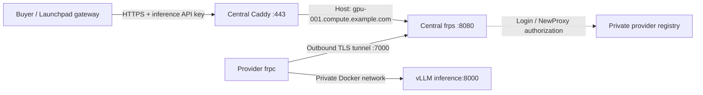

# Platform-managed inference with frpc → frps

This is the preferred supplier connectivity path. Providers only need outbound connectivity to the platform FRPS server; they do not need their own public IP, domain or router port forwarding.



The platform assigns a unique provider ID and endpoint:

```text
Provider: gpu-001
Model: Qwen/Qwen3-8B-AWQ · AWQ 4-bit · 4096 context
API base URL: https://gpu-001.compute.example.com/v1
Served model ID: qwen3-8b-awq
```

The API URL stays stable when the provider's home IP changes. All providers use the same REST request/response schema. Providers do not select arbitrary public routes.

## Platform operator: prepare the central server

Use a public Linux server with Docker, Compose v2, Python 3.11+ and OpenSSL supporting `req -addext`. The central server does **not** need a GPU.

1. Choose the control hostname, e.g. `frps.example.com`, and an inference suffix, e.g. `compute.example.com`.
2. Point `frps.example.com` and `*.compute.example.com` DNS A records to the central server. Set AAAA only if IPv6 works.
3. Allow inbound TCP 7000 (provider tunnels) and 80/443 (HTTPS certificate issuance / API traffic). Keep 7500, 8080 and 9090 off the public Internet.
4. In the repository root, generate private server settings and issue the first provider:

```bash
python3 scripts/frp_admin.py init --server frps.example.com --domain compute.example.com
python3 scripts/frp_admin.py add --id gpu-001
```

This generates a pinned self-signed tunnel certificate valid for 365 days, a shared FRP transport token, an independent credential for each provider, a private registry, and explicit Caddy hostname routes. Keys and provider credentials are never printed or committed. The generated `.secrets/frp-server/ca.crt` also serves as the tunnel server certificate; distribute its public certificate in provider bundles and plan certificate renewal before expiry. Back up server configuration securely.

5. Start the central stack:

```bash
docker compose -f frp/server/compose.yaml up -d
docker compose -f frp/server/compose.yaml logs -f frps
```

Caddy issues a public HTTPS certificate for each assigned provider hostname. It forwards only `/v1/models` and `/v1/chat/completions`, preserving the Host header for FRPS routing and promptly flushing streamed responses. Port 8080 is reachable only inside the Docker network.

To add another provider:

```bash
python3 scripts/frp_admin.py add --id gpu-002
docker compose -f frp/server/compose.yaml exec https caddy reload --config /etc/caddy/Caddyfile
```

The registry rereads registrations on each authorization request. Caddy must be reloaded after adding routes. Do not start the central stack before assigning its first provider; an empty Caddyfile has no API hosts.

## Deliver each provider's bundle privately

The operator-generated directory `.secrets/frp-bundles/gpu-001/` contains:

- `frpc.toml`: provider identity, assigned hostname, provider credential and TLS settings.
- `ca.crt`: public certificate pinned to the FRPS server hostname.
- `token`: FRP transport token.

Send **only that provider's bundle**, using a secure channel. Never send the central server directory, `server.key`, another provider's bundle or the registry. Do not add real credentials to GitHub issues, chat or the public repository.

Two distinct credentials exist:

| Credential | What it authorizes |
| --- | --- |
| FRP transport token + per-provider credential | Connecting the provider tunnel and registering only its assigned HTTP route |
| vLLM inference API key | Calling the model through that route |

The shared FRP token alone is insufficient: the private authorization plugin also checks the per-provider credential and route ownership. Before larger production rollout, consider per-provider OIDC or mTLS identities to remove the shared transport-token dependency.

## Provider: connect the Qwen REST API

On the provider's Linux NVIDIA GPU machine:

```bash
git clone https://github.com/xgaozoyoe/cc-launchpad-router.git
cd cc-launchpad-router
python3 scripts/setup.py
mkdir -p .secrets/frp-provider
chmod 700 .secrets .secrets/frp-provider
```

Copy the three files from your issued bundle into `.secrets/frp-provider/` and restrict read access to your user. Keep the directory name exactly as shown. Then:

```bash
docker compose -f compose.yaml -f compose.frpc.yaml up --build -d
docker compose -f compose.yaml -f compose.frpc.yaml logs -f frpc
```

`frpc` waits for vLLM's health check, verifies the FRPS certificate and server name, and connects outward on TCP 7000. It forwards requests to `inference:8000` on the Compose network; **do not change that to localhost**, which would refer to the frpc container itself.

Verify local inference and then the assigned public API URL:

```bash
python3 scripts/smoke.py
python3 scripts/smoke.py --base-url https://gpu-001.compute.example.com/v1
```

Use your actual assigned hostname. Both tests use the inference API key in the provider's `.env`. No GPU or central server has been deployed by this repository edit; these commands must be run on the respective machines.

## Uniform listing and management

On the central host:

```bash
python3 scripts/frp_admin.py list
curl --fail http://127.0.0.1:9090/providers
```

The private JSON list includes provider ID, model, revision, precision, context, assigned endpoint and enabled flag. Credentials are excluded. This is a **registration list**, with status `registered-unverified`; a connected tunnel is not proof of model availability or reserved GPU capacity.

For live FRP proxy / connection statistics, the FRPS dashboard is published to **central-host loopback only**, `127.0.0.1:7500`. Its random operator password is in the private generated `frps.toml`; access it through an authenticated operator SSH session or SSH port forwarding. Do not expose the dashboard or registration service publicly.

To revoke a provider for this starter:

1. Set its `enabled` field to `false` in `.secrets/frp-server/registry.json` using an operator-only editor.
2. Remove its host block from the generated Caddyfile and reload Caddy.
3. Restart FRPS to drop existing connections. This briefly disconnects **all** providers; their clients reconnect automatically, but the disabled provider is denied.

The plugin denies new sessions and routes for disabled providers; editing the registry alone does not terminate an established tunnel. A future platform controller should automate provider-specific disconnect/revoke and auditable changes.

## How Launchpad should use this

1. Create a provider record and assign its identity / hostname.
2. Deliver the issued bundle through an authenticated onboarding flow.
3. Observe the tunnel connection; separately test model identity, auth, response/streaming format and usage.
4. Measure inference throughput / latency and reserve capacity before allowing credit issuance.
5. Route buyer requests through the platform gateway, keeping supplier inference keys in a server-side vault.
6. Bind credits to the provider/resource/model revision; meter requests and handle failover in the gateway.

FRP transports requests; it does not implement credit accounting, PRL staking or burning, inference authentication, GPU ownership verification or failover. The current Launchpad UI remains a simulated setup flow and is not synchronized with this registry yet.

## Authorization rules

The small private `registry.py` plugin handles FRP `Login` and `NewProxy`. It allows an enabled, correctly authenticated provider to publish exactly one HTTP proxy named `<provider-id>.inference` on its own subdomain. It rejects other proxy types, custom domains, route groups, rewritten hosts and overlapping route paths. An unavailable or malformed registry fails closed.

The central host and FRPS operator handle unencrypted prompts inside the server's private Docker network after HTTPS termination; choose an appropriate trust and data-handling model. A compromised provider still controls its local model and can misreport its capacity. Do not equate successful FRP admission with trusted inference.

## Verification and references

FRP client/server are pinned to the same version, `v0.71.1`. Verified with official release binaries on localhost: TLS tunnel establishment, model-discovery forwarding, preserved inference API-key authentication, and rejection of another provider’s hostname. This test uses a mock inference service; Docker deployment, public ACME certificates and GPU inference were not tested.

Run unit checks with:

```bash
python3 -m unittest discover -s tests -v
```

To repeat the optional real-tunnel test, obtain official matching binaries, verify their release checksums, then run `FRP_BIN_DIR=/path/to/binaries python3 -m unittest discover -s tests -v`. Without this variable the integration test is skipped.

- [FRP subdomain routing](https://gofrp.org/en/docs/features/http-https/subdomain/)
- [FRP TLS verification](https://gofrp.org/en/docs/features/common/network/network-tls/)
- [FRP server authorization plugins](https://gofrp.org/en/docs/features/common/server-plugin/)
- [FRP dashboard](https://gofrp.org/en/docs/features/common/ui/)
