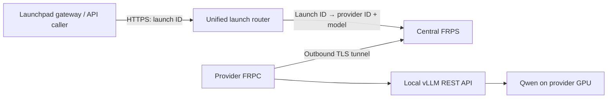

# Required hosting flow: local inference → FRPC → platform FRPS

> This is the supplier transport guide. Production credential delivery and RPC acceptance are not connected yet; see [implementation status](IMPLEMENTATION-STATUS.md). Publishing workflow target: read [Stake-gated project lifecycle](PROJECT-LIFECYCLE.md). Provider ID is now the confirmed stake tx hash; The Launch ID is reserved after finalized stake acceptance. Private deployment credential issuance remains unconnected in the active Rust service. Complete RPC acceptance within 24h of the stake block. Manual `frp_admin.py add` / `launch` commands are disabled.

**Every computing provider must connect through FRPC to the platform’s FRPS server.** The platform exposes one unified HTTPS API hostname. Each credit launch has its own unique **launch ID**, used to route requests to the correct provider and model.

```text
Unified API hostname: https://api.example.com
Launch API base URL:  https://api.example.com/launches/<launch-id>/v1
Chat endpoint:        POST /launches/<launch-id>/v1/chat/completions
Model discovery:      GET  /launches/<launch-id>/v1/models
```

The hostname is an example; the platform operator supplies the actual address. Buyers do not select a provider IP or a separate provider domain.



## Provider ID and launch ID are different

| Identifier | Purpose |
| --- | --- |
| Provider ID: full `0x` stake transaction hash | Project-specific identity assigned after finalized stake |
| Launch ID, e.g. `launch-001` | Identifies one credit launch and its provider/model binding |

The generic transport registry can support multiple launches per tunnel. The active stake workflow instead uses one project stake transaction per Provider ID; shared tunnels across projects are not integrated. Each target launch URL uses the same platform hostname. Routing IDs do not merge credit balances or grant permission to consume credits.

## 1. Receive your platform-issued FRPC bundle

After finalized stake, My launches shows your assigned Launch ID and stake-hash Provider ID. The following steps require a private bundle which the active app cannot yet issue. The intended bundle contains `frpc.toml`, `ca.crt` and `token`. It authorizes your tunnel and verifies the central server’s certificate. Use that bundle without changing the provider identity or assigned internal route.

Providers do not need their own public domain, public IP, HTTPS proxy or inbound router port forwarding. Outbound TCP access to the platform FRPS control port (default 7000) is required.

**Platform operators:** first follow [central FRPS deployment and launch provisioning](FRP-HOSTING.md). The platform must be running before a provider can connect.

## 2. Prepare the GPU host

Use Linux x86_64 with a supported NVIDIA GPU, drivers, NVIDIA Container Toolkit, Docker Engine, Compose v2 and Python 3. Start with 16GB+ VRAM as a conservative demo target; actual requirements depend on context and concurrency. This Docker kit does not accelerate inference on Apple GPUs.

```bash
git clone https://github.com/xgaozoyoe/cc-launchpad-router.git
cd cc-launchpad-router
python3 scripts/setup.py
mkdir -p .secrets/frp-provider
chmod 700 .secrets .secrets/frp-provider
```

The setup script generates the local inference API key in `.env` without printing it. Copy the three files from your issued bundle into `.secrets/frp-provider/`, then:

```bash
chmod 600 .secrets/frp-provider/frpc.toml .secrets/frp-provider/ca.crt .secrets/frp-provider/token
```

Keep both `.env` and the bundle private. The FRP credentials authorize the tunnel; the inference API key authorizes model requests. They are separate credentials.

## 3. Start Qwen and the mandatory FRPC connector

```bash
docker compose -f compose.yaml -f compose.frpc.yaml up --build -d
docker compose -f compose.yaml -f compose.frpc.yaml logs -f inference frpc
```

The model container already serves a REST API through vLLM. First startup downloads Qwen3 8B AWQ. FRPC waits for inference readiness, validates the FRPS certificate, and connects outward. Requests are forwarded to `inference:8000` on the private Docker network.

Keep `localIP = "inference"` in the bundle. `localhost` inside the FRPC container refers to the connector container, not to vLLM.

## 4. Test the assigned launch ID after provisioning

The Launch ID already exists before tunnel setup. A future production controller must provision its route and accept its RPC/model/capacity within the original stake-based deadline. Use the **same launch ID as the credit launch record**; do not invent a separate routing ID.

Example assigned launch:

| Field | Example |
| --- | --- |
| Provider ID | Full normalized stake transaction hash (`0x` + 64 hex characters) |
| Launch ID | `launch-001` |
| Launch API base URL | `https://api.example.com/launches/launch-001/v1` |
| Model | Qwen3 8B AWQ · 4-bit · 4096 context |
| Served model ID | `qwen3-8b-awq` |

Test local inference, then the launch-specific platform route:

```bash
python3 scripts/smoke.py
python3 scripts/smoke.py --base-url https://api.example.com/launches/launch-001/v1
```

Substitute the platform’s actual hostname and assigned launch ID. The smoke script checks model discovery, authentication, generated output, usage and SSE streaming.

The local URL `http://127.0.0.1:8000/v1` is for debugging on the GPU host only. The published launch endpoint always goes through the unified platform router and FRPS/FRPC tunnel.

## 5. Verify capacity before launching real credits

The registry separately records providers and launches. Each launch binds to the provider ID, exact model revision, precision and context. The generic reference registry permits shared tunnels; current project provisioning does not. Future issuance must account for all capacity commitments.

A connected tunnel proves reachability, not GPU ownership or reserved capacity. Real issuance requires model checks, measured capacity, ongoing availability monitoring and credit accounting.

**Current implementation limits:** the router is a transport starter. Its smoke-test mode forwards the supplier’s Bearer key; buyers must not receive supplier keys. Production buyer access needs the Launchpad gateway to authenticate buyers, check the selected launch’s credit balance, reserve credits, retrieve supplier keys server-side, meter accepted usage and burn the correct credits. That ledger and credential vault are not implemented here. The website’s launch records and this registry are not yet synchronized automatically.

## Troubleshooting

| Symptom | Check |
| --- | --- |
| Model does not load | NVIDIA runtime/drivers, VRAM and inference logs |
| FRPC does not start | It waits for the inference health check; initial download may take time |
| FRPS connection fails | Issued server address, outbound TCP 7000 and platform server availability |
| TLS validation fails | Correct issued CA and server name; contact the operator, do not disable verification |
| Provider/route not authorized | Use your own bundle and assigned provider identity |
| Launch route unavailable | Launch ID exists, launch/provider are enabled, and model profile matches |
| Provider inference unavailable | Provider tunnel or local inference is down |
| API returns 401 | Correct inference key for operator smoke testing; FRP token is not an inference key |

Keep the GPU host, model and FRPC online while delivering credits. Stop them with `docker compose -f compose.yaml -f compose.frpc.yaml down` when no delivery commitment is active.

See [operator provisioning and management](FRP-HOSTING.md) and [REST request examples](../README.md#rest-api).
