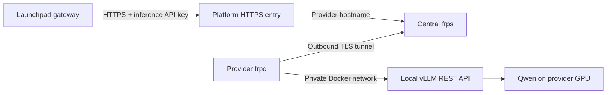

# Host your Qwen REST API through the platform FRPS server

Computing providers run **frpc beside their local model** and connect to the platform’s central **frps** server. The platform assigns each provider a stable HTTPS API address, allowing providers to be listed and managed uniformly.

The Qwen Docker container already runs a REST API through vLLM. FRP makes that API reachable through the platform; providers do not need to write another API server, buy a domain, open an inbound router port or configure their own HTTPS proxy.



## Who runs what?

| Party | Responsibility |
| --- | --- |
| Platform operator | Public FRPS server, DNS, HTTPS, provider identities and assigned routes |
| Computing provider | GPU, Qwen inference container, frpc connector and inference API key |
| Launchpad gateway | Supplier credential storage, model/capacity checks, request routing and credit accounting |

**Operators:** complete the [central server setup and provider provisioning guide](FRP-HOSTING.md#platform-operator-prepare-the-central-server) first. The steps below are for computing providers after the operator has issued their configuration.

## 1. Get your provider configuration

Ask the platform operator for your provider ID, assigned API URL and private FRPC bundle. For example:

| Field | Example |
| --- | --- |
| Provider ID | `gpu-001` |
| Public API base URL | `https://gpu-001.compute.example.com/v1` |
| Catalog model | Qwen3 8B AWQ · 4-bit · 4096 context |
| Served model ID | `qwen3-8b-awq` |

The bundle contains `frpc.toml`, `ca.crt` and `token`. It identifies your provider, pins the FRPS server certificate and authorizes only your assigned hostname. Use the operator-issued values; the example domains in this guide are placeholders.

Keep the bundle private. It does not include your vLLM inference API key, and you should never receive the central server’s private key or another provider’s credentials.

## 2. Prepare your GPU machine

Use Linux x86_64 with a supported NVIDIA GPU, NVIDIA drivers, Docker Engine, Compose v2, NVIDIA Container Toolkit and Python 3. Start with 16GB+ VRAM as a conservative demo target; actual requirements depend on context and concurrency. Apple GPU acceleration is not supported by this Docker kit.

```bash
git clone https://github.com/xgaozoyoe/cc-launchpad-router.git
cd cc-launchpad-router
python3 scripts/setup.py
mkdir -p .secrets/frp-provider
chmod 700 .secrets .secrets/frp-provider
```

The setup script generates your inference API key in `.env` without printing it. Copy the three files from your issued bundle into `.secrets/frp-provider/`, then restrict their permissions:

```bash
chmod 600 .secrets/frp-provider/frpc.toml .secrets/frp-provider/ca.crt .secrets/frp-provider/token
```

Do not commit `.env` or `.secrets/`, or paste their contents into the website demo.

## 3. Start the model and FRPC connector

```bash
docker compose -f compose.yaml -f compose.frpc.yaml up --build -d
docker compose -f compose.yaml -f compose.frpc.yaml logs -f inference frpc
```

The first startup downloads the model. Once vLLM passes its health check, frpc connects outward to the central server on TCP 7000. It verifies the server certificate and forwards requests to `inference:8000` on the Docker network.

Keep `localIP = "inference"` in the issued configuration. `localhost` inside the frpc container refers to that container, not to vLLM.

## 4. Test the local and public REST APIs

In another terminal in the same repository folder:

```bash
python3 scripts/smoke.py
python3 scripts/smoke.py --base-url https://gpu-001.compute.example.com/v1
```

Replace the public hostname with your actual assigned URL. The tests read your inference key from `.env` and check authentication, model discovery, real generation, token usage and SSE streaming.

| Access | URL |
| --- | --- |
| Local debugging on the GPU machine | `http://127.0.0.1:8000/v1` |
| Platform and remote API access | `https://<provider-id>.<platform-domain>/v1` |

Both use `Authorization: Bearer <INFERENCE_API_KEY>`. The public entry forwards `GET /v1/models` and `POST /v1/chat/completions`; the local `/health` probe is not exposed. See the [README REST API examples](../README.md#rest-api) for request and response formats.

Your GPU machine and containers must remain running while serving credits. Stop them with `docker compose -f compose.yaml -f compose.frpc.yaml down`; stopping the tunnel makes the assigned API unavailable.

## 5. Register and verify capacity before launching credits

The operator’s private registry records the provider ID, exact model/revision, quantization, context and assigned API URL. Operators can list entries with `python3 scripts/frp_admin.py list` or query the private `/providers` endpoint on the central host.

Registration has status **registered-unverified**. A working FRP tunnel proves connectivity, not available GPU capacity. The platform must separately verify the model, measure throughput/latency, reserve capacity and monitor availability before real credit issuance. Supplier inference keys belong in a platform server-side vault.

The current website uses simulated setup and inference and is not synchronized with this registry yet. This documentation does not deploy a central server or enable real credit issuance.

## Troubleshooting

| Symptom | Check |
| --- | --- |
| Model does not load | NVIDIA runtime/drivers, free VRAM and inference logs |
| FRPC never starts | It waits for inference health; the initial model download can take time |
| Connection refused / timeout | Issued server address, outbound TCP 7000 and central FRPS availability |
| TLS verification fails | Correct issued CA certificate and server name; contact the operator rather than disabling verification |
| Provider or route not authorized | Correct private bundle, enabled provider record and assigned hostname; do not edit provider ID/subdomain independently |
| Local API works but public API fails | FRPC logs, central DNS/HTTPS and provider route registration |
| API returns 401 | Inference API key must match the provider’s `.env`; the FRP token is a separate credential |
| Model not found | Request `qwen3-8b-awq`, matching `/v1/models` |

## Further documentation

- [Central FRPS deployment, provisioning, registry, monitoring and revocation](FRP-HOSTING.md)
- [Standalone hosting alternatives](STANDALONE-HOSTING.md) — for services outside the platform-managed FRP flow
- [NVIDIA Container Toolkit installation](https://docs.nvidia.com/datacenter/cloud-native/container-toolkit/latest/install-guide.html)
