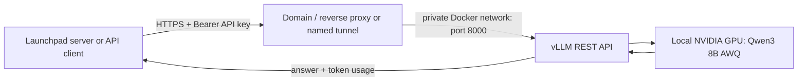

# Standalone REST API hosting alternatives

**Platform suppliers should use [FRPC → central FRPS](FRP-HOSTING.md) for assigned URLs and uniform provider management.** The options below are standalone alternatives.

The Docker kit already starts **vLLM, an inference HTTP server**. You do not need to write another REST backend just to call the model.



GitHub hosts the source and these instructions. **GitHub Pages and Vercel do not run the GPU container.** Your GPU machine must remain online to deliver inference.

## 1. Start the local API

On your Linux x86_64 NVIDIA GPU machine, open the repository folder:

```bash
python3 scripts/setup.py
docker compose up --build -d
docker compose logs -f inference
```

After model loading finishes:

```bash
python3 scripts/smoke.py
```

Local API base URL: `http://127.0.0.1:8000/v1`.
Served model ID: `qwen3-8b-awq`.
The API key is generated in your local `.env`; do not commit or paste it into the website demo.
The smoke script reads it without printing it. `/v1/models` and `/v1/chat/completions` require it.

`localhost` means the machine making the request. A cloud platform cannot call your home PC by using `127.0.0.1`.

## 2. Choose the hosting path

| Your machine | Use | Needs |
| --- | --- | --- |
| Cloud GPU / public server | Caddy HTTPS profile | Domain, public IP, reachable TCP 80/443 |
| Home / office behind NAT or CGNAT | Named Cloudflare Tunnel | Cloudflare-managed domain, named tunnel, outbound connectivity |
| Only trying on the same machine | Local API | No domain or external access |

### A. Public GPU server: automatic HTTPS with Caddy

1. Point your domain's DNS A record to the GPU server's public IPv4 address. Only add AAAA if IPv6 actually works.
2. Allow inbound TCP 80/443 in the cloud firewall and host firewall. Leave port 8000 bound to localhost.
3. Add these values to `.env` (replace with your own hostname and email):

```dotenv
INFERENCE_DOMAIN=inference.example.com
ACME_EMAIL=operator@example.com
```

4. Start the HTTPS profile:

```bash
docker compose -f compose.yaml -f compose.https.yaml up --build -d
docker compose -f compose.yaml -f compose.https.yaml logs -f https
```

Caddy obtains and renews a TLS certificate, routes the two supported REST paths to `inference:8000`, and flushes streamed output promptly. API-key authentication remains enforced by vLLM. Other paths, including `/health`, are not published by this profile.

Your external API base URL is now `https://inference.example.com/v1`.

Check from another machine with the same API key supplied as `INFERENCE_API_KEY` in its environment (or run from the original machine with the local `.env`):

```bash
python3 scripts/smoke.py --base-url https://inference.example.com/v1
```

No browser login should be required for this API. Do not disable TLS verification to make a test pass.

### B. Home GPU behind a router: named Cloudflare Tunnel

This connects outward from the GPU host; no incoming port forwarding is needed.

1. Use your Cloudflare account and a domain managed there. Create a **named, remotely managed Cloudflare Tunnel** in its dashboard.
2. Configure a published application route:
   - Hostname: `inference.example.com`
   - Service type: HTTP
   - Service URL: `inference:8000`
   - Do not enter `localhost:8000`: the tunnel connector runs in a separate container, where localhost refers to itself.
3. On the GPU host create a private `.secrets` directory and save only the tunnel token in `.secrets/tunnel-token` using your local editor. Do not include a `docker run` command or quotation marks in the file. Do not paste the token into chat or commit it.

```bash
mkdir -p .secrets
chmod 700 .secrets
# Create .secrets/tunnel-token in your local editor before the next command.
chmod 600 .secrets/tunnel-token
```

4. Start the connector on the same Docker network as inference:

```bash
docker compose -f compose.yaml -f compose.tunnel.yaml up --build -d
docker compose -f compose.yaml -f compose.tunnel.yaml logs -f tunnel
```

5. Test the HTTPS URL:

```bash
python3 scripts/smoke.py --base-url https://inference.example.com/v1
```

Keep vLLM Bearer authentication enabled. A Cloudflare Access interactive email login would block machine API clients; if you add Access, configure service-to-service credentials in the gateway too. This minimal profile does not implement those additional credentials.

For a public supplier service, restrict tunnel routes to required API paths and add suitable rate limits before accepting buyer traffic. Tunnel services terminate TLS and handle transit traffic; account for that when choosing how to handle prompts.

**Do not use a temporary Quick Tunnel for credit-backed service:** its hostname changes, it has no uptime guarantee, and it does not support SSE streaming. Use the named tunnel or the Caddy route.

The optional Caddy / cloudflared profiles use upstream rolling tags. Review the chosen images and lock image digests before a production rollout. No external service is started by merely downloading this repository.

## 3. What goes into Launchpad?

| Field | Example |
| --- | --- |
| Resource name | My Qwen GPU |
| Catalog model | Qwen3 8B AWQ, 4-bit, 4K context |
| API base URL | `https://inference.example.com/v1` |
| Served model ID | `qwen3-8b-awq` |
| Supplier credential | API key, held only in a future platform server-side vault |

The current website stores configuration only and runs simulated checks. It does not connect to this endpoint or have a credential vault. Real launch eligibility also needs model/revision verification, measured capacity, ongoing monitoring and a request ledger; neither a configured URL nor PRL alone proves GPU ownership.

## 4. Troubleshooting

| Symptom | Check |
| --- | --- |
| Container exits before model loading | NVIDIA runtime / drivers, API key, logs |
| GPU out of memory | Lower context and concurrency; actual VRAM exceeds weight-file size |
| Local API works, remote URL fails | DNS, firewall, certificate, proxy or tunnel status |
| Tunnel returns 502 | Service must be `inference:8000` on the same Docker network |
| 401 / 403 on API | Bearer key must match the GPU host's `.env` |
| Model not found | Use `qwen3-8b-awq`, not the Hugging Face repository name |
| Streaming fails but normal requests work | Avoid Quick Tunnel; check buffering and timeout rules |
| Container stays unhealthy | First download may be slow; inspect inference logs. Health readiness is not proof of service capacity |

## References

- [Qwen vLLM deployment](https://qwen.readthedocs.io/en/latest/deployment/vllm.html)
- [Caddy HTTPS reverse proxy](https://caddyserver.com/docs/quick-starts/reverse-proxy)
- [Named Cloudflare Tunnel](https://developers.cloudflare.com/tunnel/get-started/)
- [Cloudflare tunnel run options](https://developers.cloudflare.com/tunnel/reference/run-parameters/)
- [Quick Tunnel limitations](https://developers.cloudflare.com/tunnel/get-started/quick-tunnels/)
